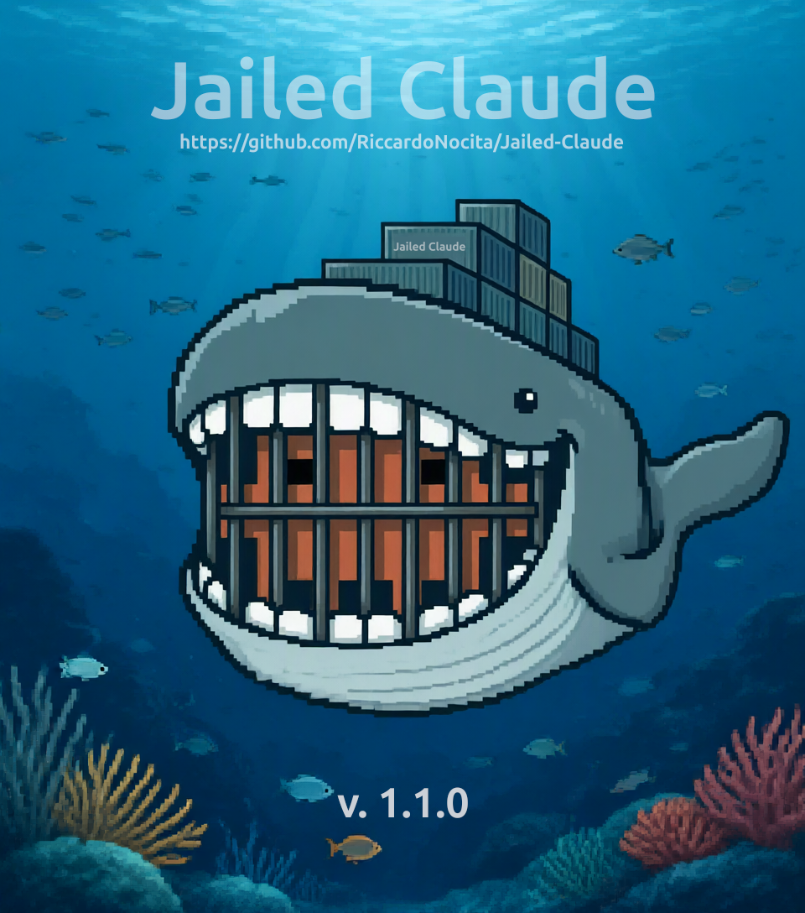

# jailed-claude

> Run [Claude Code](https://code.claude.com/) inside an isolated Docker sandbox — switch **LLM-provider profiles** with a single keystroke, keep your history intact, and optionally **cut the network off**.




## 🚀 Quick Start

Just run the following commands:

```bash
# 1. Download only the installer and execute it
curl -fsSL https://raw.githubusercontent.com/RiccardoNocita/Jailed-Claude/master/install.sh | bash

# 2. Run (Wait only first time for image build)
jailed-claude
```

Take a look at the [scenario examples](./examples/).

## What it is (and isn't)

`jailed-claude` is a thin **wrapper** around the official Claude Code CLI. It does **not** modify, patch, rebrand, or change how Claude Code thinks or behaves — the agent stays 100% stock. What it adds is a layer of *control and isolation* around it:

- **Sandboxing** — every session runs in a throwaway Docker container that can only see the folder you're working in (plus your Claude history).
- **Provider profiles** — you decide *which LLM provider / endpoint / model* Claude talks to, using small `conf/*.conf` files. Swap providers without touching anything else.
- **Optional network lockdown** — with `--isolated`, all traffic to the upstream provider (Anthropic) is blocked, so your code never reaches the cloud and nothing can phone home or auto-update.

> In short: same Claude Code, different cage. You pick who it talks to — and whether it's allowed to talk at all.

## Features

- 🐳 Isolated `docker run` on demand (no long-lived containers). Can't access files outside the trusted dir by mistake (Finally...)
- 🔌 Pluggable LLM-provider profiles via `conf/*.conf` (endpoint + auth + models)
- 🧠 History & config preserved: only `~/.claude/` and `~/.claude.json` are bind-mounted
- 🎯 Interactive model picker (fuzzy with [fzf](https://github.com/junegunn/fzf), numeric fallback) — `default` lets Claude decide
- 🔒 Isolated mode that blackholes the upstream domains (privacy / no telemetry / no auto-updates)
- 🎛️ Strict mode (`--strict`) that pins **all** egress to the single `ANTHROPIC_BASE_URL` endpoint via an L3 nftables firewall — everything else is dropped, even raw IPs
- 🛡️ Hardened container: drops all capabilities, `no-new-privileges`, runs as your UID/GID
- ⌨️ Ctrl+C aborts any prompt; non-interactive friendly via env overrides
- 📦 One-line remote install


## How the sandbox works

| Aspect | Behavior |
|---|---|
| Working dir | Your current folder is bind-mounted at the **same path** inside the container |
| Home | Only `~/.claude/` and `~/.claude.json` are mounted — nothing else in `$HOME` is exposed |
| User | Runs as your host UID:GID (no root, no stray files) |
| Capabilities | `--cap-drop=ALL`, `--security-opt=no-new-privileges`, `--init` |
| Host reachability | `host.docker.internal` mapped to the host by default (for local gateways) — disable with `JAILED_ALLOW_INTERNAL=0`; forced off in strict mode |
| Egress (strict mode) | With `--strict`, all traffic is dropped at L3 except TCP to the `ANTHROPIC_BASE_URL` host:port (nftables in a shared netns — see *Strict mode*) |
| Image | Built on first run from `Dockerfile.jailed-claude` (`node:24-slim` + Claude Code + git/ripgrep/bash) |

## Installation

```
  .-------------------------------.
  |  It was just an rm * -rf ...  |
  '-------------------------------'
            \
      ┃      ┃      ┃      ┃     
   ━━━╋━━━━━━╋━━━━━━╋━━━━━━╋━━━  
      ┃      ┃      ┃      ┃     
      ┃██████┃██████┃██████┃     
      ┃████  ┃██████┃  ████┃     
   ███┃██████┃██████┃██████┃███  
   ███┃██████┃██████┃██████┃███  
      ┃██████┃██████┃██████┃     
   ━━━╋━━━━━━╋━━━━━━╋━━━━━━╋━━━  
      ┃  ██  ┃█    █┃  ██  ┃     
      ┃  ██  ┃█    █┃  ██  ┃     
      ┃      ┃      ┃      ┃   
```

### Requirements
- Docker Engine ≥ 20.10 (or Docker Desktop)
- `bash`, and `curl` or `wget`
- *(optional)* [`fzf`](https://github.com/junegunn/fzf) for the fuzzy picker (installed automatically by the installer, see below)

### One-liner
```bash
curl -fsSL https://raw.githubusercontent.com/RiccardoNocita/Jailed-Claude/master/install.sh | bash
```
The installer downloads the needed files from this repo into `~/.local/share/jailed-claude` and symlinks the command onto your `PATH`.
If `fzf` is missing, it also tries to install it with the system package manager (brew, apt-get, dnf, yum, pacman, zypper, apk — may ask for `sudo`). To skip that step:
```bash
curl -fsSL https://raw.githubusercontent.com/RiccardoNocita/Jailed-Claude/master/install.sh | INSTALL_FZF=0 bash
```

## Usage

### Basic
```bash
jailed-claude                          # pick a profile + model, then you're in Claude Code
jailed-claude -p "summarize this repo" # any Claude Code flag is passed through
```

On launch it asks, in order:
1. **Isolate from the upstream provider?** (default: *yes*)
2. **Which config profile?** (`conf/*.conf`)
3. **Which model?** (`default` = let Claude decide)

### Provider profiles

Default location: 
>  $HOME/.local/share/jailed-claude/conf

Each `conf/*.conf` is a named *identity* for an LLM provider — the endpoint, credentials and models to use:

Example: **`conf/local.conf`**
```bash
JAILED_MODELS=unsloth/Qwen3.8-27B-GGUF,unsloth/Qwen3.6-35B-A3B-GGUF
ANTHROPIC_BASE_URL=http://host.docker.internal:11434
# ANTHROPIC_AUTH_TOKEN=sk-...
# API_FORCE_IDLE_TIMEOUT=0
# API_TIMEOUT_MS="3600000"
```

`conf/default.conf` ships with **no** environment variables, so Claude Code runs exactly as it would natively. This is how you "manage provider identities": one file per provider, chosen at launch.

### Isolated mode (network lockdown)
By default the wrapper asks whether to isolate; press Enter (yes) and it rewrites `/etc/hosts` inside the container to point every host in the blocklist at `127.0.0.1`. Result: **no** traffic to those upstreams — only your local endpoint works. Useful for:

- **Privacy** — source code never leaves the machine
- **Integrity** — nothing remote can alter behaviour or push unwanted changes
- **No auto-updates / telemetry** — the upstream is simply unreachable

Force it from the CLI with `--isolated` (skips the prompt).

#### Custom blocklist (`JAILED_CLAUDE_BLOCK_HOSTS`)
The list of blackholed hosts defaults to the Anthropic domains and can be fully replaced via the `JAILED_CLAUDE_BLOCK_HOSTS` environment variable (space-separated hostnames):

```bash
# Block Anthropic plus any other host you want unreachable
export JAILED_CLAUDE_BLOCK_HOSTS="api.anthropic.com statsig.anthropic.com sentry.io"
jailed_claude --isolated
```

Malformed entries are skipped with a warning; if no valid host remains, the wrapper refuses to start in isolated mode (an empty list would silently disable isolation). The active list is printed on launch.

> **Limitations — read this.** The lockdown works at the *name-resolution* layer only:
> - hosts **not** in the list resolve and connect normally — this is not an air gap;
> - direct IP connections, DNS-over-HTTPS or hardcoded endpoints bypass it;
> - `host.docker.internal` is mapped by default for local gateways — you can cut it with `JAILED_ALLOW_INTERNAL=0`.
>
> For a hard guarantee that works at L3 — not just name resolution — use `--strict` (*Strict mode* below): it drops **everything** except the pinned endpoint.

### Strict mode (egress pinning)
`--isolated` blackholes a list of hosts at the name-resolution layer. `--strict` is the opposite and much stronger: the container may talk to **exactly one** endpoint — the host:port of `ANTHROPIC_BASE_URL` from your selected profile (or your environment, if the profile doesn't set it) — and *nothing else*.

```bash
jailed-claude --strict   # with a profile whose ANTHROPIC_BASE_URL is your only allowed endpoint
```

How it works:

- the wrapper resolves the target to its IPv4 address(es) **on the host** (fail-closed if unresolvable), pins `hostname → IPs` in `/etc/hosts`, and points DNS at a dead nameserver so any other name fails fast;
- a **sidecar** container (with `NET_ADMIN`, alive for the whole session) applies an nftables ruleset in its own network namespace: only loopback, established/related traffic and new TCP to the pinned IP(s) on the target port are accepted — every other packet (other IPs, UDP, ICMP, all IPv6) is dropped by policy, and Docker's embedded DNS on `127.0.0.11` is explicitly blocked (it would otherwise forward queries upstream);
- the main container joins that network namespace via `--network container:` **without** `NET_ADMIN`, so code inside the jail cannot flush or rewrite the ruleset;
- `ANTHROPIC_BASE_URL` is forwarded to the container (also when it comes from your environment) and `CLAUDE_CODE_DISABLE_NONESSENTIAL_TRAFFIC=1` is forced, so Claude Code does not attempt telemetry, auto-updates or error reporting;
- `host.docker.internal` is forced off and the `--isolated` blocklist is not applied (`--strict` supersedes it).

Requirements: `http(s)` scheme, host resolvable to at least one IPv4 address (IP literals like `10.10.10.10` work too; IPv6-only targets are rejected). The sidecar and its network are removed automatically on exit (orphan recovery after a hard kill: `docker ps -a --filter name=jailed_strict`).

> **Limitations.** TCP only on the target port (no UDP/HTTP3); IPs are pinned at launch — re-run if the endpoint's addresses change; a same-host gateway must be addressed by its concrete IP (`host.docker.internal` does not resolve on Linux hosts).
>
> **What "one endpoint" really means.** The pin is enforced at **L3/L4 (IP + TCP port)**, not at L7 (hostname/HTTP):
> - if the target hostname sits behind a CDN, load balancer or shared hosting (Cloudflare, AWS ALB, …), the pinned IP:port also serves *other* domains — code in the jail can reach them by setting a different TLS SNI / HTTP `Host` header (domain fronting). For a real guarantee, point `ANTHROPIC_BASE_URL` at an endpoint whose IP is dedicated to it (e.g. a private gateway such as `10.10.10.10:8888`);
> - the allowed endpoint is, by definition, an egress channel: everything the model sees reaches it. If it is a proxy/gateway that can forward requests elsewhere (other providers, web-search tools, generic reverse proxy), data can leave through it. `--strict` limits *where* traffic goes, not *what* the endpoint does with it.

## Configuration reference

### Keys inside a `conf/*.conf` file
| Key | Meaning |
|---|---|
| `JAILED_MODELS` | Comma-separated model IDs offered in the picker (`default` is always added) |
| any other `KEY=VALUE` | Passed to the container as an environment variable (e.g. `ANTHROPIC_BASE_URL`, `ANTHROPIC_API_KEY`) |

> Values are read **verbatim to the end of the line**: there is no inline-comment support, so put `#` comments on their own line. Surrounding single/double quotes are stripped and an optional `export ` prefix is tolerated.

### Environment overrides (for automation / non-interactive use)
| Variable | Purpose |
|---|---|
| `JAILED_CLAUDE_IMAGE` | Docker image tag (default `jailed-claude:latest`) |
| `JAILED_CONF` | Skip the profile picker and use this conf file directly |
| `JAILED_CLAUDE_BLOCK_HOSTS` | Space-separated hostnames to blackhole in isolated mode (default: Anthropic domains — see *Custom blocklist*) |
| `JAILED_STRICT_READY_TIMEOUT` | Seconds to wait for the strict sidecar to apply its ruleset (default `15`) |
| `ANTHROPIC_BASE_URL` | In a conf file (or your environment, as fallback): besides being passed to Claude Code, it becomes the **only allowed endpoint** in `--strict` mode — see *Strict mode* |
| `JAILED_ALLOW_INTERNAL` | Map `host.docker.internal` to the host gateway. Default: enabled; set `0`/`false`/`no`/`off` to drop the mapping (gateway profiles that use that hostname will then fail) |

## Project layout
```
jailed-claude/
├── jailed-claude              # wrapper / entrypoint
├── Dockerfile.jailed-claude   # sandbox image definition
├── strict-init.sh             # --strict sidecar init (nftables egress pinning)
├── install.sh                 # remote installer (curl | bash)
├── conf/
│   ├── default.conf           # stock Claude Code (no env vars)
│   └── local.conf             # example local-gateway profile
├── examples/                  # scenario walkthroughs
└── docs/                      # screenshots referenced in the README
```

## Security notes
- The container only ever sees your CWD + `~/.claude{,.json}`; the rest of your filesystem is invisible to it.
- All Linux capabilities are dropped and privilege escalation is disabled.
- In isolated mode, egress to the listed upstreams is cut at the name-resolution layer (see *Limitations* in the Isolated mode section).
- In strict mode, egress is enforced at **L3** by nftables in a shared network namespace: only the pinned `ANTHROPIC_BASE_URL` host:port (TCP) is reachable — including against raw-IP connections — and the jailed container has no capability to modify the ruleset.
- For a stricter sandbox you can add `--read-only --tmpfs /tmp` to the run (see source).

## Uninstall
```bash
rm -f ~/.local/bin/jailed-claude            # or wherever the symlink lives
rm -rf ~/.local/share/jailed-claude
docker rmi jailed-claude:latest             # optional
```

## Disclaimer
Independent project. Not affiliated with, endorsed by, or maintained by Anthropic. "Claude Code" and related marks are the property of their respective owners.

## License
Released under the [MIT License](LICENSE) — use it, modify it, and ship it however you like.
