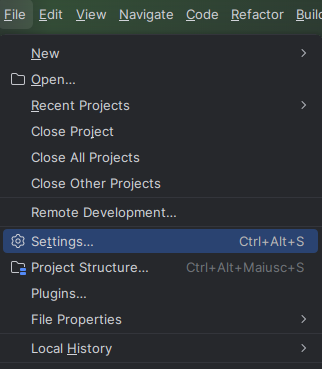
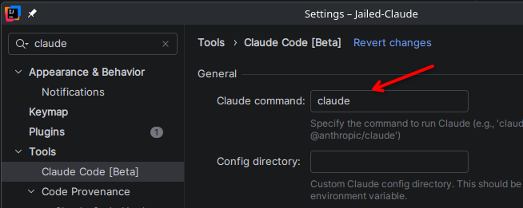
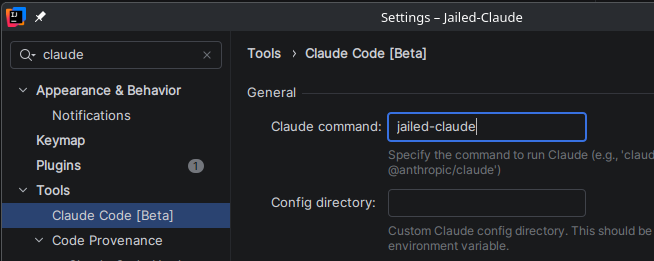
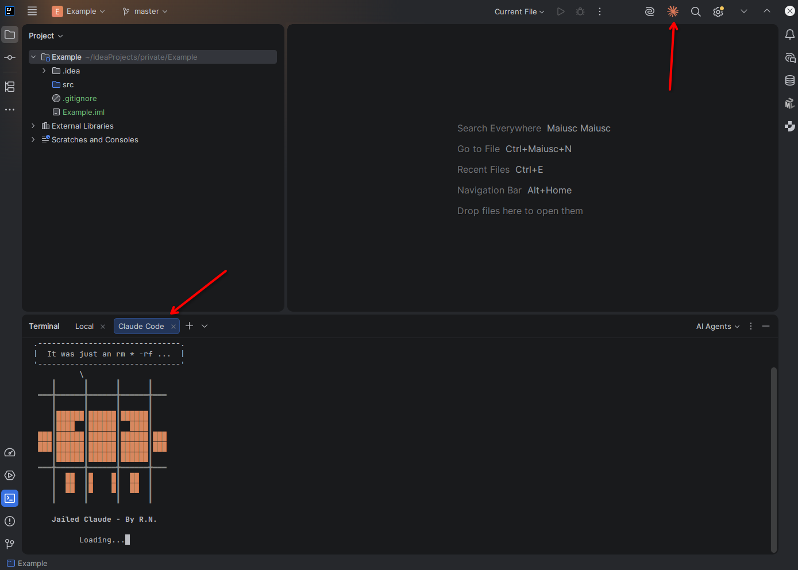
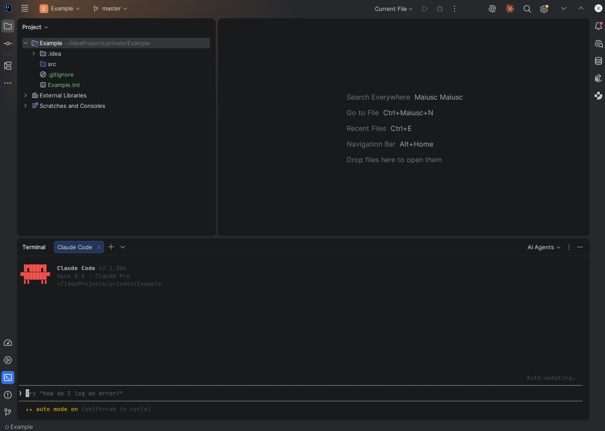

# jetbrains IDE Integration Instructions

We are configuring an integration with the IDE. Follow the steps below to complete the setup.

| Step | Instructions                                                                    |               Screenshot                |
|:----:|---------------------------------------------------------------------------------|:---------------------------------------:|
|  1   | Open the **Settings**.                                                          |  |
|  2   | Search for **Claude Code** plugin and install it if it is not already installed. |     |
|  3   | Rename the **command executable**.                                              |     |
|  4   | Start Claude from icon                                                          |     |
|  5   | **Ready** to code                                                               |     |
